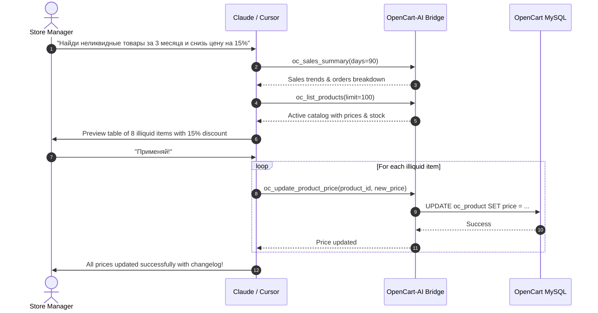

# Prompt Scenario: Illiquid Inventory Markdown & Stock Clearance

> **Goal:** Identify slow-moving / illiquid catalog items over the past 90 days and apply a 15% markdown or discount to accelerate inventory turnover.

---

### Russian Prompt (Промпт на русском)

```markdown
Используй подключенные MCP-инструменты OpenCart:
1. Вызови `oc_sales_summary` за последние 90 дней и `oc_top_products`.
2. С помощью `oc_list_products` найди товары, у которых остаток на складе больше 10 штук, но продаж за последние 3 месяца не было или было меньше 2 штук.
3. Составь список найденных неликвидных товаров с их текущими ценами и остатками.
4. Рассчитай новую цену со скидкой 15% (округли до целого или двух знаков).
5. Запроси подтверждение на обновление цен. После подтверждения примени новую цену через `oc_update_product_price` для каждого товара.
```

---

### English Prompt

```markdown
Using the connected OpenCart MCP tools:
1. Inspect store velocity via `oc_sales_summary` (days: 90) and `oc_top_products`.
2. Call `oc_list_products` to identify catalog items with stock > 10 units that have zero or low sales velocity in the last 3 months.
3. Present a markdown table with Product ID, Model, Current Stock, Current Price, and Proposed Markdown Price (-15%).
4. Ask for user confirmation. Upon confirmation, execute `oc_update_product_price` for each approved product.
```

---

### Execution Flow in Claude Desktop / Cursor


